# Doris SSO Datasource：Keycloak 单机从零部署指南

适用目标：Ubuntu 24.04 x86_64 单机验证环境，从安装 Docker 开始，部署 Keycloak、Grafana、Doris FE/BE，跑通用户登录、只读授权和业务查询。管理员完成部署后，普通用户只需登录、选择库表和查询。

**验证边界：** 配套容器实际运行于 Ubuntu 22.04 x86_64、Docker 29.1.3 / Compose 5.1.3。Ubuntu 24.04 的 Docker 安装步骤按官方文档核对，尚未在全新 24.04 虚拟机中实测；不能将本文标注为“Ubuntu 24.04 全流程已验证”。后文记录实际容器验收结果。

**访问方式：** 浏览器通过 SSH 隧道访问 localhost；宿主机端口只绑定 127.0.0.1。Keycloak 使用 start-dev 和本地持久化数据库，HTTP 仅用于这套隧道内的验证链路；Doris MySQL 连接仍强制 TLS 并验证 CA 和主机名。这是单机功能验证示例，正式部署需要独立规划 HTTPS、Keycloak 外部数据库、高可用和备份。

## 1. 版本、资源与配套文件

建议至少 8 vCPU、16 GiB 内存、60 GiB 可用磁盘；需要 root/sudo、SSH 和访问镜像仓库的网络。浏览器电脑需要 OpenSSH 客户端。

| 组件 | 本文固定版本 / 来源 |
|---|---|
| Keycloak | quay.io/keycloak/keycloak:26.7.3 |
| Grafana | dogstack/dog-stack-grafana:20261013；界面版本 13.3.0-local |
| Doris | apache/doris:all-in-one-4.1.3；一个容器内运行一个 FE 和一个 BE |
| Grafana Doris 插件 | 本文配套包中的 1.1.16 Linux amd64 构建；以 SHA256SUMS 为准 |
| FE OIDC 插件 | fe-authentication-plugin-oidc-1.0.0.jar |
| OIDC 依赖 | lib/nimbus-jose-jwt-10.0.1.jar |

从本文末尾下载配套附件 **doris-oidc-keycloak-lab-20261015.tar.gz** 和同名 `.sha256` 校验文件。包中包含全部部署脚本、Grafana 插件和 FE OIDC JAR；不含 .env、密码、私钥、用户令牌或现网配置。不要用公开旧版 Release 替代本包；公开旧版并未验证本流程。无法取得这两个附件时，先联系文档维护者提供它们，不要继续安装不明来源的 JAR。

本镜像存在较长 OIDC 认证报文的兼容限制：本次探测中 1000 字节测试令牌可进入 JWT 校验，1100 字节及以上出现握手失败。本文使用 RSA 2048 位下游签名密钥和少量组验证；增加大量组、更长 issuer/UID 或换用更大密钥后，必须重新验收，不能据此推断生产兼容性。

## 2. 参数替换表：先看清哪些需要改

| 参数 | 是否替换 | 获取方式 / 本文默认 |
|---|---|---|
| SERVER_SSH_HOST | 必改 | 你的验证服务器可达 IPv4 或域名；仅用于 SSH/scp，示例占位地址 192.0.2.10 不能直接使用 |
| SSH 用户与密钥 | 按实际修改 | 示例使用 root；普通 sudo 用户上传到自己的目录后再移动至 /opt |
| PUBLIC_HOST | 保留 localhost | 指浏览器地址，不是远程服务器 IP；本教程依赖 SSH 隧道 |
| GRAFANA_PORT / KEYCLOAK_PORT | 端口空闲时保留 | 31830 / 31880；若改，Compose、SSH 隧道、浏览器地址、Client 回调须一起改 |
| DORIS_PORT / JWKS_PORT | 通常保留 | 宿主机 31930 / 31899；容器内部仍是 doris:9030 / grafana:8999 |
| company / grafana | 主线原样保留 | realm / Client ID；更改时须同步 OAuth URL、数据源 issuer 与 audience、初始化脚本 |
| /reader → doris_reader | 主线原样保留 | 用户组完整路径 → Doris 只读业务角色；组名创建时只输入 reader |
| /grafana-admins | 主线原样保留 | 仅授予部署管理员 Grafana 组织 Admin；不等于 Doris admin |
| 三个部署密码 | 自动生成 | prepare.sh 写入服务器 .env；只在需要时查看，不复制进文档 |
| 用户初始密码 | 管理员设置 | GUI 手动设置；可选初始化脚本会生成 LAB_USER_PASSWORD 写入 .env |
| 数据源 UID / integration / audience | 保存后获取 | UID 从数据源编辑页 URL 最后一段获取；其余以页面生成 SQL 为准 |
| 镜像 digest / 安装包 SHA256 | 不自行填写 | 配套包校验清单与实测记录提供；不用“latest”替换 |

## 3. 在全新 Ubuntu 服务器安装 Docker

执行位置：验证服务器。先 `sudo -i`，后续服务器命令都在 root shell 执行。已有 Docker 的机器先确认版本，避免覆盖正在使用的安装。本节安装步骤参考 [Docker Ubuntu 官方文档](https://docs.docker.com/engine/install/ubuntu/)。

```bash
sudo -i
cat /etc/os-release
uname -m
apt-get update
apt-get install -y ca-certificates curl openssl python3 tar
install -m 0755 -d /etc/apt/keyrings
curl -fsSL https://download.docker.com/linux/ubuntu/gpg -o /etc/apt/keyrings/docker.asc
chmod a+r /etc/apt/keyrings/docker.asc
. /etc/os-release
cat >/etc/apt/sources.list.d/docker.sources <<EOF
Types: deb
URIs: https://download.docker.com/linux/ubuntu
Suites: ${UBUNTU_CODENAME:-$VERSION_CODENAME}
Components: stable
Architectures: amd64
Signed-By: /etc/apt/keyrings/docker.asc
EOF
apt-get update
apt-get install -y docker-ce docker-ce-cli containerd.io docker-buildx-plugin docker-compose-plugin
systemctl enable --now docker
docker version
docker compose version
docker run --rm hello-world
```

预期：架构 x86_64，Docker 服务可用，`docker compose version` 成功，hello-world 打印安装成功信息。Docker 包版本由 apt 仓库提供；容器组件版本在 Compose 中固定，不代表本节已验证所有未来 Docker 版本。

```bash
# 执行位置：新验证服务器 root shell；为 Doris 配置内核参数
printf 'vm.max_map_count=2000000
' >/etc/sysctl.d/90-doris-oidc-lab.conf
sysctl --system
swapon --show
# 新验证服务器若启用了 swap，关闭后再部署；同时按系统规范禁用重启后自动启用的 swap
swapoff -a
# 查看默认端口是否被占用：有输出时先定位进程，不能直接停掉其他服务
ss -lnt | grep -E ':31830|:31880|:31899|:31930' || true
```

## 4. 上传、校验并解压配套包

执行位置：浏览器所在电脑的终端。先下载附件到当前目录，然后将 SERVER_SSH_HOST 的示例值替换成实际服务器地址；示例 scp 使用 root。

```bash
SERVER_SSH_HOST='192.0.2.10'  # 必改：你的服务器地址
scp doris-oidc-keycloak-lab-20261015.tar.gz doris-oidc-keycloak-lab-20261015.tar.gz.sha256 "root@${SERVER_SSH_HOST}:/tmp/"
```

执行位置：服务器 root shell。

```bash
cd /tmp
sha256sum -c doris-oidc-keycloak-lab-20261015.tar.gz.sha256
install -d -m 0755 /opt/doris-oidc-lab
# 此目录应为空；已有环境不要覆盖解压
test -z "$(ls -A /opt/doris-oidc-lab)"
tar -xzf /tmp/doris-oidc-keycloak-lab-20261015.tar.gz -C /opt/doris-oidc-lab
cd /opt/doris-oidc-lab
sha256sum -c SHA256SUMS
cp .env.example .env
chmod 600 .env
```

所有校验必须返回 OK；任意失败先停止。目录中应包含 compose.yaml、prepare.sh、wait-ready.sh、configure-keycloak.py、configure-datasource.py、configure-doris.sh、init.sql、provisioning、plugins、enterprise-plugins。

## 5. 完整环境变量和 Compose

文件：`/opt/doris-oidc-lab/.env.example`。以下为完整文件，不需要与其他片段拼接。

```dotenv
# Keep localhost: browser access uses the documented SSH tunnel, NOT the remote server IP.
PUBLIC_HOST=localhost
# OPTIONAL: keep these values when ports are free. Change before creating the Keycloak Client.
GRAFANA_PORT=31830
KEYCLOAK_PORT=31880
DORIS_PORT=31930
JWKS_PORT=31899
```

文件：`/opt/doris-oidc-lab/compose.yaml`。以下为完整文件，不需要与其他片段拼接。

```yaml
name: doris-oidc-lab
services:
  keycloak:
    image: quay.io/keycloak/keycloak:26.7.3@sha256:29be7252db0a106f1cd2ac17b9a56ff2668073da645638a38b9fc67deeb2d6c4
    command: [start-dev, '--hostname=http://${PUBLIC_HOST:-localhost}:${KEYCLOAK_PORT:-31880}']
    environment:
      KC_BOOTSTRAP_ADMIN_USERNAME: admin
      KC_BOOTSTRAP_ADMIN_PASSWORD: ${KEYCLOAK_ADMIN_PASSWORD:?Run prepare.sh first}
      KC_HTTP_PORT: '8080'
    ports: ['127.0.0.1:${KEYCLOAK_PORT:-31880}:8080']
    volumes: [keycloak-data:/opt/keycloak/data]
    restart: unless-stopped
  doris:
    image: apache/doris:all-in-one-4.1.3@sha256:82a5cabc7900ebcd3d080412d636c0cebd6602799fffe2605c652b2ea7d42609
    environment:
      FE_HEAP: 2048m
      START_TIMEOUT: '240'
      FE_CONFIG_EXTRA: |
        experimental_enable_ssl = true
        ssl_trust_store_type = PKCS12
        ssl_force_client_auth = false
        mysql_ssl_default_ca_certificate = /lab-tls/ca.p12
        mysql_ssl_default_ca_certificate_password = ${TLS_STORE_PASSWORD:?Run prepare.sh first}
        mysql_ssl_default_server_certificate = /lab-tls/server.p12
        mysql_ssl_default_server_certificate_password = ${TLS_STORE_PASSWORD}
    ports: ['127.0.0.1:${DORIS_PORT:-31930}:9030']
    volumes:
      - doris-meta:/opt/apache-doris/fe/doris-meta
      - doris-storage:/opt/apache-doris/be/storage
      - ./enterprise-plugins:/opt/apache-doris/fe/plugins/authentication/oidc:ro
      - ./tls:/lab-tls:ro
      - ./fe-custom.conf:/opt/apache-doris/fe/conf/fe_custom.conf:ro
    ulimits:
      nofile: {soft: 65536, hard: 65536}
    healthcheck:
      test: [CMD-SHELL, 'test -f /opt/apache-doris/.ready']
      interval: 5s
      timeout: 5s
      retries: 60
      start_period: 30s
    restart: unless-stopped
  grafana:
    image: dogstack/dog-stack-grafana:20261013@sha256:cffeffaa1dd3efceed1db335a33470ef594b68eb662a3227de5bf9665f2e9b9d
    ports: ['127.0.0.1:${GRAFANA_PORT:-31830}:3000', '127.0.0.1:${JWKS_PORT:-31899}:8999']
    environment:
      GF_SERVER_ROOT_URL: http://${PUBLIC_HOST:-localhost}:${GRAFANA_PORT:-31830}
      GF_SECURITY_ADMIN_USER: admin
      GF_SECURITY_ADMIN_PASSWORD: ${GRAFANA_ADMIN_PASSWORD:?Run prepare.sh first}
      GF_USERS_ALLOW_SIGN_UP: 'false'
      GF_USERS_AUTO_ASSIGN_ORG_ROLE: Viewer
      GF_AUTH_ANONYMOUS_ENABLED: 'false'
      GF_AUTH_GENERIC_OAUTH_ENABLED: 'true'
      GF_AUTH_GENERIC_OAUTH_NAME: Keycloak
      GF_AUTH_GENERIC_OAUTH_ALLOW_SIGN_UP: 'true'
      GF_AUTH_GENERIC_OAUTH_CLIENT_ID: grafana
      GF_AUTH_GENERIC_OAUTH_SCOPES: openid profile email
      GF_AUTH_GENERIC_OAUTH_AUTH_URL: http://${PUBLIC_HOST:-localhost}:${KEYCLOAK_PORT:-31880}/realms/company/protocol/openid-connect/auth
      GF_AUTH_GENERIC_OAUTH_TOKEN_URL: http://keycloak:8080/realms/company/protocol/openid-connect/token
      GF_AUTH_GENERIC_OAUTH_API_URL: http://keycloak:8080/realms/company/protocol/openid-connect/userinfo
      GF_AUTH_GENERIC_OAUTH_ID_TOKEN_ATTRIBUTE_NAME: id_token
      GF_AUTH_GENERIC_OAUTH_USE_REFRESH_TOKEN: 'true'
      GF_AUTH_GENERIC_OAUTH_USE_PKCE: 'true'
      GF_AUTH_GENERIC_OAUTH_LOGIN_ATTRIBUTE_PATH: preferred_username
      GF_AUTH_GENERIC_OAUTH_NAME_ATTRIBUTE_PATH: name
      GF_AUTH_GENERIC_OAUTH_EMAIL_ATTRIBUTE_PATH: email
      GF_AUTH_GENERIC_OAUTH_GROUPS_ATTRIBUTE_PATH: groups
      GF_AUTH_GENERIC_OAUTH_ROLE_ATTRIBUTE_PATH: "contains(groups[*], '/grafana-admins') && 'Admin' || 'Viewer'"
      GF_PLUGINS_ALLOW_LOADING_UNSIGNED_PLUGINS: velodb-doris-app,velodb-doris-datasource
      GF_PLUGINS_FORWARD_HOST_ENV_VARS: velodb-doris-datasource
      GF_PLUGINS_PREINSTALL_DISABLED: 'true'
      GF_ANALYTICS_CHECK_FOR_UPDATES: 'false'
      VELODB_DORIS_SSO_SIGNING_KEY_FILE: /run/secrets/doris-sso.pem
      VELODB_DORIS_SSO_ISSUER: http://${PUBLIC_HOST:-localhost}:${JWKS_PORT:-31899}
      VELODB_DORIS_SSO_JWKS_PUBLIC_URL: http://grafana:8999/.well-known/jwks.json
      VELODB_DORIS_SSO_JWKS_LISTEN_ADDR: :8999
      VELODB_DORIS_SSO_ALLOW_INSECURE_HTTP: 'true'
    volumes:
      - grafana-data:/var/lib/grafana
      - ./provisioning/doris-app.yaml:/etc/grafana/provisioning/plugins/doris-app.yaml:ro
      - ./plugins/velodb-doris-app:/var/lib/grafana/plugins/velodb-doris-app:ro
      - ./secrets/doris-sso.pem:/run/secrets/doris-sso.pem:ro
    restart: unless-stopped
volumes:
  keycloak-data:
  doris-meta:
  doris-storage:
  grafana-data:
```

注意：`GF_AUTH_GENERIC_OAUTH_*` 配置 Grafana 对 Keycloak 的登录；`VELODB_DORIS_SSO_*` 配置插件签发给 Doris 的另一枚令牌。前者 issuer 为 `http://localhost:31880/realms/company`、audience 为 `grafana`；后者 issuer 为 `http://localhost:31899`、audience 为 `velodb-doris:实际数据源UID`。两个 issuer 和两个 audience 不要混用。

浏览器使用 localhost:31880；Grafana 的 token/userinfo 请求走 keycloak:8080。数据源保留对外 issuer 进行校验，同时通过 oidcBackchannelUrl 请求内部地址。Doris 读取 JWKS 使用 grafana:8999；这些容器服务名无需写入浏览器电脑 hosts。

配置来源统一为新数据卷中的环境变量。已有 Grafana 若曾在 Authentication 页面/API 保存过 OAuth，数据库配置可能优先，不能只修改环境变量就认定生效。本教程不复用旧数据卷。

## 6. 生成证书、签名私钥并启动

执行位置：服务器 `/opt/doris-oidc-lab`。prepare.sh 生成 CA、含 DNS:doris 和 IP:127.0.0.1 SAN 的 FE 证书、PKCS12 文件、RSA 2048 签名私钥和随机部署密码。签名私钥归 UID 472 所有、权限 0400；Grafana 只需要 FE CA 公共证书。已有密钥不会在重跑脚本时自动覆盖。

```bash
cd /opt/doris-oidc-lab
bash prepare.sh
docker compose pull
docker compose up -d
bash wait-ready.sh
docker compose ps
docker compose exec -T doris mysql -h127.0.0.1 -P9030 -uroot --ssl-mode=VERIFY_IDENTITY --ssl-ca=/lab-tls/ca.crt -e 'SELECT 1; SHOW BACKENDS;'
```

预期：准备脚本输出 tls/server.crt: OK；等待脚本报告三个服务已就绪；TLS 客户端返回 1，SHOW BACKENDS 中 Alive=true。Doris 官方容器内使用 MySQL 客户端支持 --ssl-mode；不要换成参数不同的 MariaDB 客户端直接照抄。

Doris 4.1.3 此镜像的 TLS 开关名称为 experimental_enable_ssl；不能直接把其他版本 enable_ssl 配置复制进来。证书路径和口令通过 FE_CONFIG_EXTRA 写入容器配置；OIDC chain 使用后续单独挂载的 fe-custom.conf 持久化。

文件：`/opt/doris-oidc-lab/provisioning/doris-app.yaml`。以下为完整文件，不需要与其他片段拼接。

```yaml
apiVersion: 1
apps:
  - type: velodb-doris-app
    org_id: 1
    disabled: false
```

上面的 provisioning 自动启用 Doris App。Grafana 插件目录同时包含 App 和嵌套 datasource；两个插件 ID 都列入未签名插件白名单。这里安装的是配套包指定构建，不需要执行 npm/yarn 构建。

## 7. 在电脑建立 SSH 隧道

执行位置：浏览器所在电脑。此终端在使用期间保持运行，访问不通时先检查它是否仍连接。

```bash
SERVER_SSH_HOST='192.0.2.10'  # 必改，与上传时相同
ssh -N -o ExitOnForwardFailure=yes \
  -L 31830:127.0.0.1:31830 \
  -L 31880:127.0.0.1:31880 \
  -L 31899:127.0.0.1:31899 \
  "root@${SERVER_SSH_HOST}"
```

浏览器访问 Grafana http://localhost:31830/login；Keycloak http://localhost:31880/admin/master/console/。不要替换为服务器 IP。若电脑端口已占用，关闭自己的旧隧道或先统一修改端口，不能只改浏览器 URL。

## 8. Keycloak 创建业务 realm

使用 prepare.sh 写入 .env 的 KEYCLOAK_ADMIN_PASSWORD，以用户名 admin 登录 Keycloak。密码只在服务器安全终端查看，不截图、不发给普通用户。Manage realms → Create realm → Realm name 填 company，Enabled 开启，Create 后切换到 company。不要在 master 中创建业务 Client。

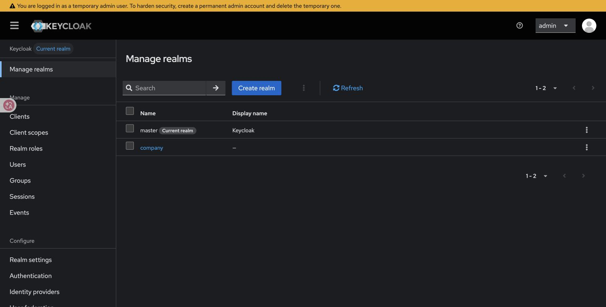

图 8a：Manage realms 完整页面，确认 company realm。

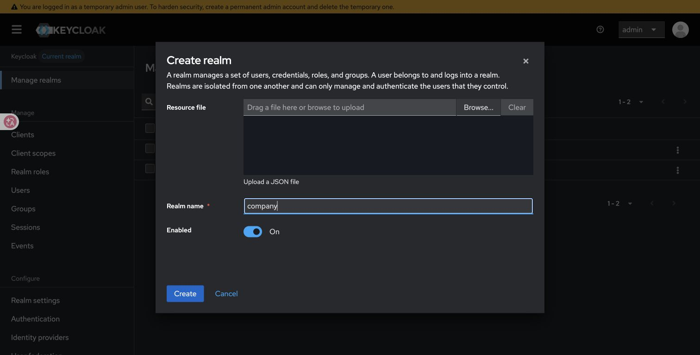

图 8b：Create realm 对话框，填写 company；截图展示填写步骤，不重复创建已存在 realm。

## 9. Keycloak 创建 Public Client 并要求 PKCE

company → Clients → Create client；Client type=OpenID Connect，Client ID=grafana → Next。Client authentication=Off，Standard flow=On，其余授权流程关闭；Require PKCE=On，PKCE Method=S256。Authorization 保持 Off；Doris 的数据权限由后面的角色授权决定。Public Client 不需要 Client Secret。

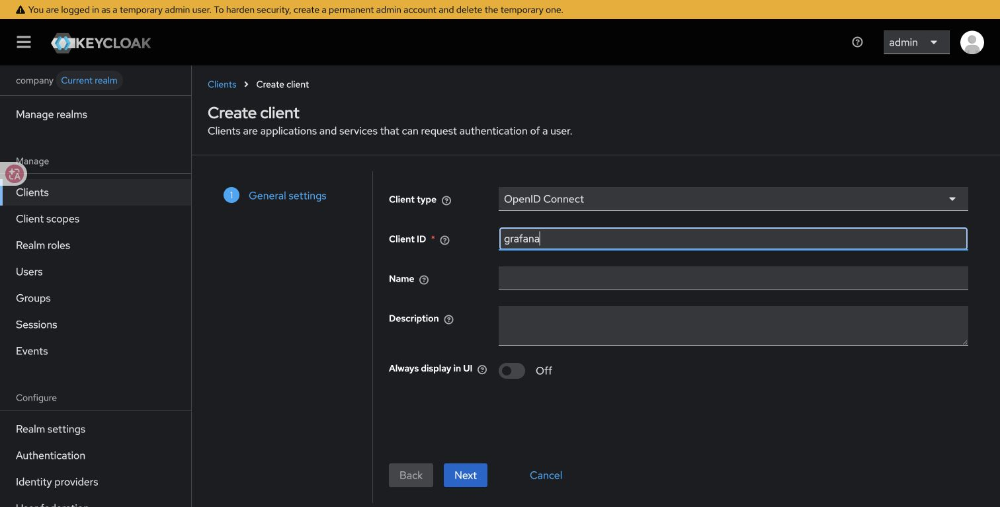

图 9a：Client 创建向导，Client ID 为 grafana。

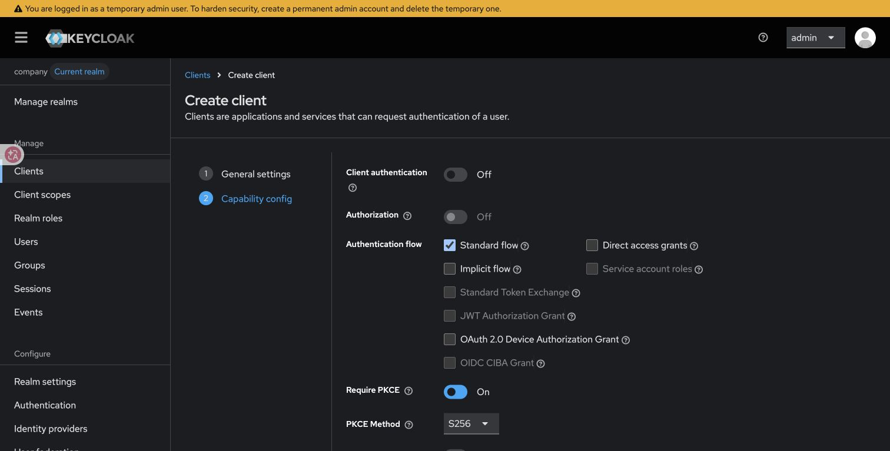

图 9b：Public Client、Standard flow 和 Require PKCE。

Login settings：Root URL / Home URL=`http://localhost:31830`；Valid redirect URIs=`http://localhost:31830/login/generic_oauth`；Web origins=`http://localhost:31830`；Save。不要填通配符回调。

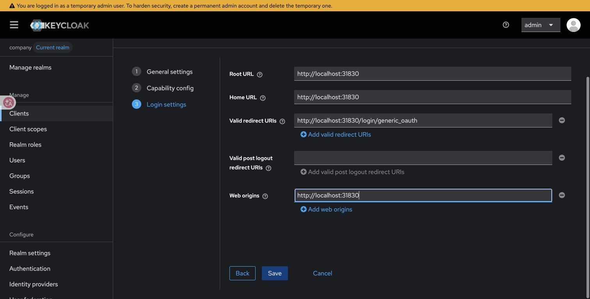

图 9c：完整填写回调地址；已有 grafana Client 时核对而不重复创建。

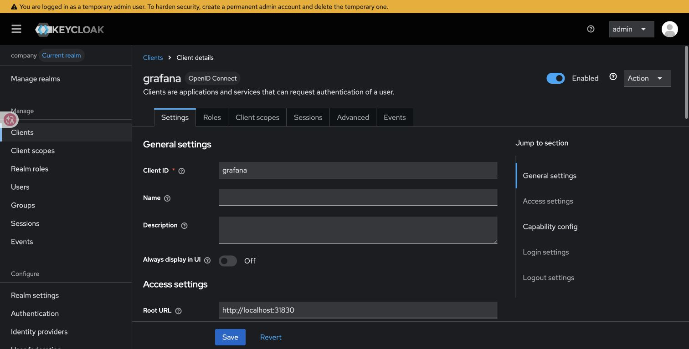

图 9d：创建后 Settings → Capability config 中核对 Require PKCE=On、S256。

## 10. Keycloak 创建组和三个验收用户

Groups → Create group，分别创建 reader、grafana-admins。组名不含斜杠，完整路径分别为 /reader、/grafana-admins。

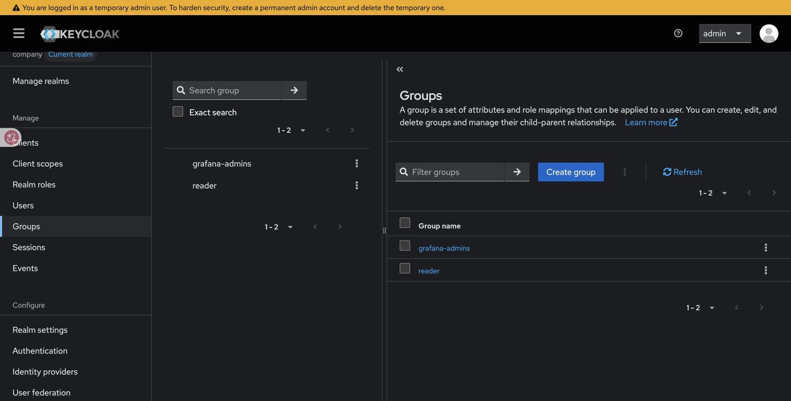

图 10a：业务组完整页面。

Users → Add user，分别创建 reader、deploy-admin、outsider；均 Enabled=On，填写 Username、Email、First name、Last name，完成必填资料后 Create。示例邮箱可使用 reader@example.com 等测试地址；本验证环境不要求邮件验证，不对未控制的邮箱发送邮件。

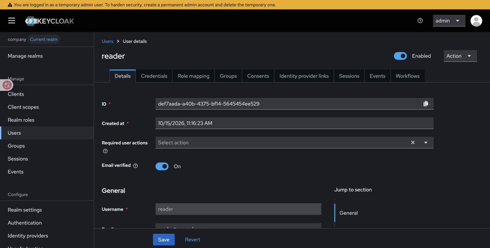

图 10b：reader 的完整用户资料；新用户从 Users → Add user 创建，截图展示创建后的核对页。

每个用户进入 Credentials → Set password（已存在密码时显示 Reset password），由管理员设置初始密码。本单机验收将 Temporary=Off；如果保留 On，先完成首次改密后再验收登录。不要把密码写进教程或截图。

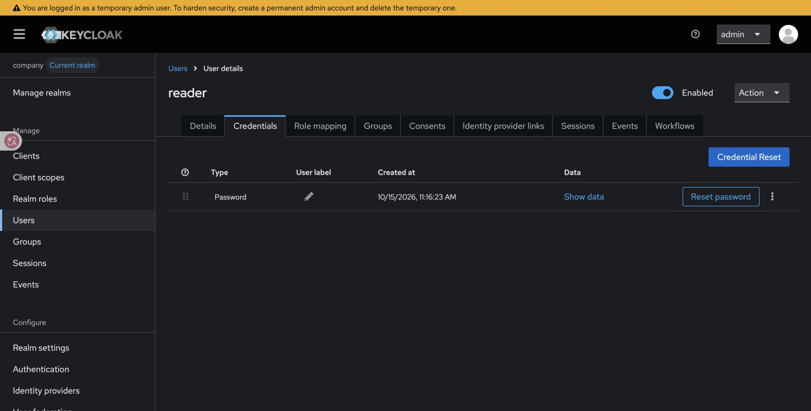

图 10c：Credentials 页面和凭据设置入口，截图不包含密码。

Users → 用户 → Groups → Join Group：reader 只加入 /reader；deploy-admin 加入 /reader 和 /grafana-admins；outsider 不加入任何业务组。检查表格 Path，不能把 Realm roles 当成 groups。

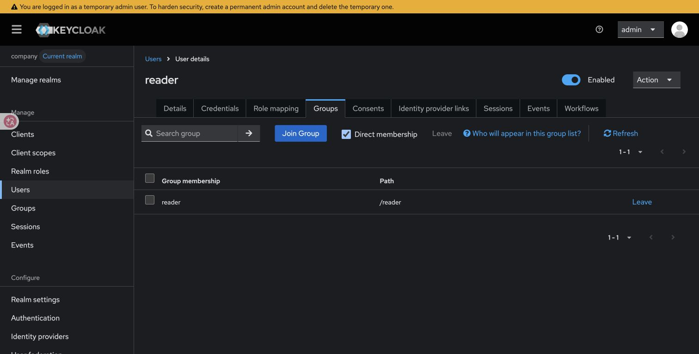

图 10d：reader 只属于 /reader；部署管理员的 /grafana-admins 仅用于管理 Grafana。

可选：不手动创建时，在服务器执行 `python3 configure-keycloak.py`，它按以上规则创建 company、Client、mapper 和三个用户，并将随机用户初始密码存入 .env 的 LAB_USER_PASSWORD。已存在用户不会重置密码。此脚本是上述 UI 步骤的替代方式，不必两种方式都执行。

## 11. Keycloak 添加 groups mapper

Clients → grafana → Client scopes → grafana-dedicated → Mappers → Add mapper → By configuration → Group Membership。若 grafana-groups 已存在，打开检查，避免重复映射相同 claim。

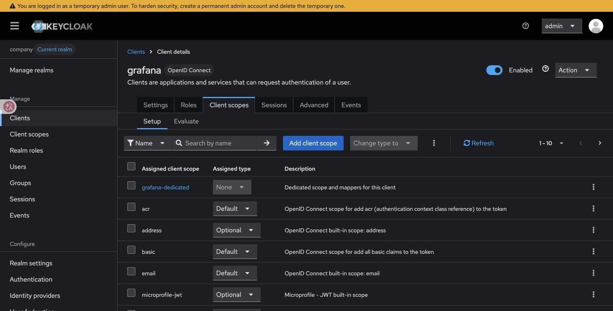

图 11a：Client scopes 中的 grafana-dedicated。

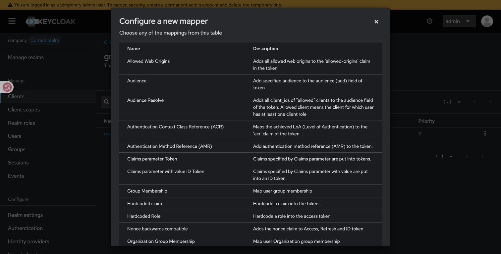

图 11b：By configuration 中选择 Group Membership。

Name=grafana-groups；Token Claim Name=groups；Full group path=On；Add to ID token=On；其余 token 开关在本示例中为 Off，然后 Save。只建组和加入用户并不会自动产生 groups claim。修改后退出再登录以取得新 ID Token。

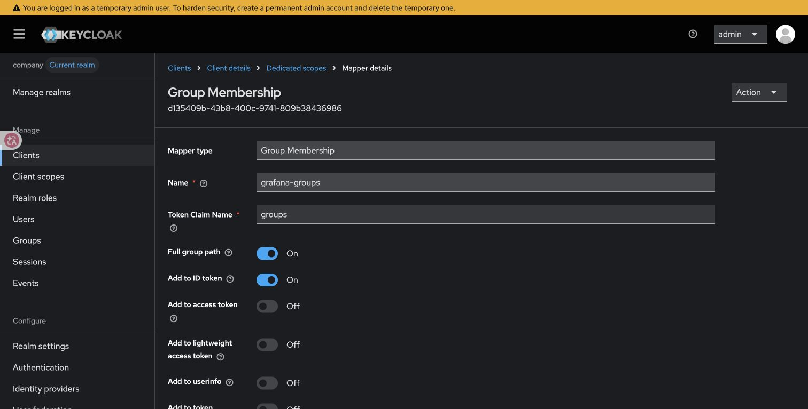

图 11c：groups claim、完整路径和 ID Token 开关。

## 12. Doris 初始化样例表和只读角色

执行位置：服务器 `/opt/doris-oidc-lab`。先检查 FE 和 BE 就绪，再初始化。init.sql 只创建本教程的 oidc_demo.logs，并插入当前时间的一条测试记录。重复执行会增加一条记录，不要求清库。

文件：`/opt/doris-oidc-lab/init.sql`。以下为完整文件，不需要与其他片段拼接。

```sql
CREATE DATABASE IF NOT EXISTS oidc_demo;
CREATE TABLE IF NOT EXISTS oidc_demo.logs (
  `timestamp` DATETIMEV2(3) NOT NULL,
  `service_name` VARCHAR(64) NOT NULL,
  `body` STRING
) DUPLICATE KEY (`timestamp`, `service_name`)
DISTRIBUTED BY HASH (`service_name`) BUCKETS 1
PROPERTIES ('replication_num'='1');
INSERT INTO oidc_demo.logs VALUES (NOW(3), 'oidc-lab', 'OIDC deployment verified');
CREATE ROLE IF NOT EXISTS doris_reader;
GRANT SELECT_PRIV ON oidc_demo.* TO ROLE doris_reader;
```

```bash
cd /opt/doris-oidc-lab
docker compose exec -T doris mysql -h127.0.0.1 -P9030 -uroot <init.sql
docker compose exec -T doris mysql -h127.0.0.1 -P9030 -uroot -e 'SELECT COUNT(*) FROM oidc_demo.logs;'
```

预期首次返回 1。此处 root 仅用于容器内部初始化；业务用户随后使用 OIDC，不需要 Doris root 密码。

## 13. 创建 Grafana Doris 数据源：完整页面分步截图

打开 Grafana 登录页，点击 Sign in with Keycloak，以 deploy-admin 登录。该账号因为属于 /grafana-admins，获得 Grafana 组织 Admin；reader 和 outsider 为 Viewer。Connections → Add new connection → Doris → Add new data source。

| 表单字段 | 本示例填写 |
|---|---|
| Doris host / MySQL port | doris / 9030，使用容器内部地址，不填 localhost:31930 |
| Enable SSO | On，自动转发 OAuth 用户身份 |
| Enable TLS / Verify Doris TLS certificate | 保持 On，不关闭证书校验 |
| Default database | oidc_demo |
| OIDC issuer | http://localhost:31880/realms/company |
| OIDC audience / Grafana OAuth Client ID | grafana |
| Skip IDP TLS certificate verification | Off；HTTP 模式另外在下一步设置，不靠此开关开启 |
| IDP CA certificate | 本 HTTP 隧道示例留空；它与 Doris CA 不同 |
| group mapping | /reader → doris_reader |

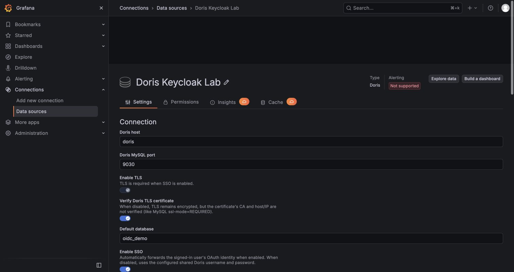

图 13a：完整桌面页面的连接、TLS、默认库和 SSO 设置。

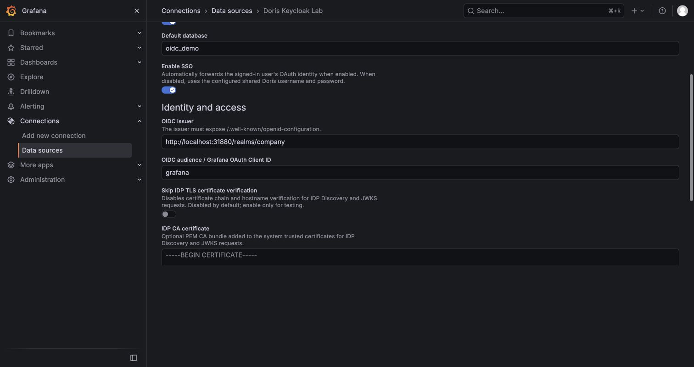

图 13b：完整桌面页面的 OIDC issuer、audience 与 IDP 校验设置。

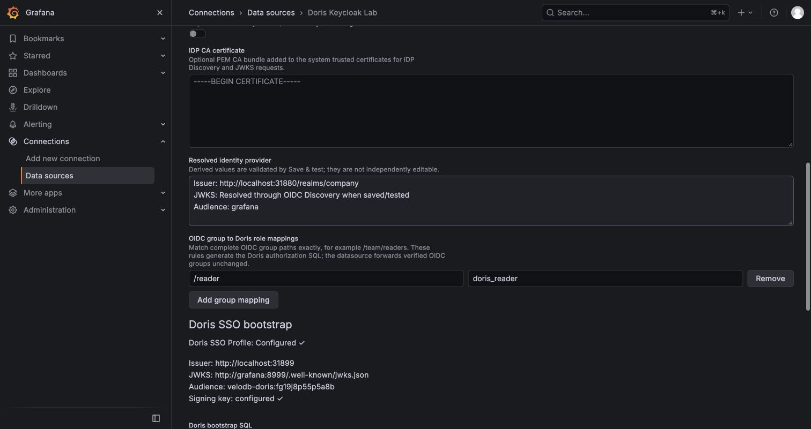

图 13c：完整桌面页面的只读映射与下游 SSO Profile；未裁成窄长截图。

首次点击 Save & test 先保存数据源，此时未安装 CA、尚未执行 Doris 集成 SQL，测试报错是预期的中间状态，不能当成部署完成。记录编辑页 URL 最后一段 UID；不要把截图中的 UID 复制到新环境。

## 14. 保存 Doris CA 和单机 HTTP 回源设置

执行位置：服务器 `/opt/doris-oidc-lab`。此版本未提供 Doris CA 文本框，用管理员 API 设置 secureJsonData.tlsCACert。脚本同时开启单机 HTTP IDP 模式 allowInsecureIdp，并设置容器内部 oidcBackchannelUrl；不会关闭 Doris TLS 校验。

```bash
cd /opt/doris-oidc-lab
DS_UID='REPLACE_WITH_SAVED_DATASOURCE_UID'  # 必改：刚保存的数据源 URL 最后一段
python3 configure-datasource.py "$DS_UID"
```

脚本拒绝非法 UID、核对 datasource 类型、保留已有 JSON 配置、保存修改前的 datasource-before.json，并检查 CA 已存入安全字段。该 JSON 备份不包含 Grafana 已加密秘密的明文，不能当作完整密钥备份。预期输出 CA saved；UID 同时写入 datasource.uid。刷新数据源页面，避免旧表单再次覆盖刚保存的回源设置。

文件：`/opt/doris-oidc-lab/configure-datasource.py`。以下为完整文件，不需要与其他片段拼接。

```python
#!/usr/bin/env python3
"""Complete the saved datasource's CA + HTTP lab flags through Grafana Admin API."""
import base64, json, os, re, sys, urllib.request
from pathlib import Path
os.chdir(Path(__file__).resolve().parent)
if len(sys.argv)!=2 or not re.fullmatch(r'[A-Za-z0-9_-]+',sys.argv[1]):
    raise SystemExit('Usage: python3 configure-datasource.py DATASOURCE_UID (from the saved datasource URL)')
env=dict(line.split('=',1) for line in Path('.env').read_text().splitlines() if line and not line.startswith('#') and '=' in line)
uid=sys.argv[1]
url='http://127.0.0.1:'+env.get('GRAFANA_PORT','31830')+'/api/datasources/uid/'+uid
auth=base64.b64encode(('admin:'+env['GRAFANA_ADMIN_PASSWORD']).encode()).decode()
def request(method,body=None):
    req=urllib.request.Request(url,method=method,data=None if body is None else json.dumps(body).encode(),headers={'Authorization':'Basic '+auth,'Content-Type':'application/json'})
    with urllib.request.urlopen(req) as r: return json.load(r)
ds=request('GET')
assert ds['type']=='velodb-doris-datasource', 'Wrong datasource type'
Path('datasource-before.json').write_text(json.dumps(ds,indent=2)); Path('datasource-before.json').chmod(0o600)
ds['jsonData']['allowInsecureIdp']=True
ds['jsonData']['oidcBackchannelUrl']='http://keycloak:8080'
ds['secureJsonData']={'tlsCACert':Path('tls/ca.crt').read_text()}
result=request('PUT',ds)
assert result['datasource']['secureJsonFields']['tlsCACert'], 'CA not saved'
Path('datasource.uid').write_text(uid+'\n')
print('CA saved; lab HTTP IDP and container backchannel set. Refresh datasource page. UID:',uid)
```

## 15. 安装 FE 认证能力、创建 integration 并启用 chain

FE OIDC JAR 和 nimbus 依赖已由步骤 4 配套包提供，并通过 Compose 只读挂载至 `/opt/apache-doris/fe/plugins/authentication/oidc`，所以不需要另外猜 FE_HOME 或下载地址。目录结构：

```text
enterprise-plugins/
  fe-authentication-plugin-oidc-1.0.0.jar
  lib/
    nimbus-jose-jwt-10.0.1.jar
```

插件=提供 OIDC 验证能力；integration=声明信任的 issuer、JWKS、audience 和 claim；role mapping=把 /reader 映射到只读角色；authentication_chain=选择启用的 integration。仅复制 JAR 或仅保存 Grafana 表单，都不完成 Doris 授权。

新建且只有一个 integration 的本验证环境执行下列脚本。脚本读取真实 datasource.uid，生成可审阅的 bootstrap.sql，执行集成和映射，动态启用认证链，再将同一值写入宿主机 fe-custom.conf。该文件已挂载到 FE，容器重建仍保留。

```bash
cd /opt/doris-oidc-lab
bash configure-doris.sh
cat bootstrap.sql
cat fe-custom.conf
docker compose exec -T doris mysql -h127.0.0.1 -P9030 -uroot -e "SHOW FRONTEND CONFIG LIKE 'authentication_chain';"
```

文件：`/opt/doris-oidc-lab/configure-doris.sh`。以下为完整文件，不需要与其他片段拼接。

```bash
#!/usr/bin/env bash
set -euo pipefail
cd "$(dirname "$0")"
set -a; source .env; set +a
uid=$(cat datasource.uid)
[[ $uid =~ ^[A-Za-z0-9_-]+$ ]] || { echo 'Invalid datasource.uid'; exit 1; }
integration="grafana_doris_sso_${uid//-/_}"
# SQL is generated from the saved datasource UID, never copied from another environment.
cat > bootstrap.sql <<SQL
CREATE AUTHENTICATION INTEGRATION \`$integration\` PROPERTIES (
 'type'='oidc', 'enable_jit_user'='true',
 'oidc.issuer'='http://${PUBLIC_HOST:-localhost}:${JWKS_PORT:-31899}',
 'oidc.jwks_uri'='http://grafana:8999/.well-known/jwks.json',
 'oidc.allowed_audiences'='velodb-doris:$uid',
 'oidc.required_scopes'='doris.query',
 'oidc.username_claim'='username', 'oidc.subject_claim'='sub',
 'oidc.groups_claim'='doris_groups', 'oidc.allowed_algorithms'='RS256'
);
CREATE ROLE MAPPING \`${integration}_roles\` ON AUTHENTICATION INTEGRATION \`$integration\`
 RULE (USING CEL 'has_group("/reader")' GRANT ROLE doris_reader);
ADMIN SET FRONTEND CONFIG ('authentication_chain'='$integration');
SQL
count=$(docker compose exec -T doris mysql -h127.0.0.1 -P9030 -uroot -N -e "SELECT COUNT(*) FROM information_schema.authentication_integrations WHERE name='$integration'")
[[ $count == 0 ]] || { echo 'Integration already exists. Review bootstrap.sql; existing configuration was retained.'; exit 1; }
docker compose exec -T doris mysql -h127.0.0.1 -P9030 -uroot <bootstrap.sql
# Rewrite the existing bind-mounted file in place, so a restart sees the new content.
printf '# Single-integration isolated lab only\nauthentication_chain = %s\n' "$integration" >fe-custom.conf
docker compose exec -T doris mysql -h127.0.0.1 -P9030 -uroot -e "SHOW FRONTEND CONFIG LIKE 'authentication_chain';"
```

页面生成的 SQL 会包含 CREATE ROLE doris_reader；步骤 12 已创建该角色，所以不要重复整段照抄。脚本不会重建已有 integration，也不会自动覆盖其他认证链；已有集群不应直接使用此单 integration 初始化脚本。新数据源 UID 变化后需要建立对应集成，不能只改 Grafana。

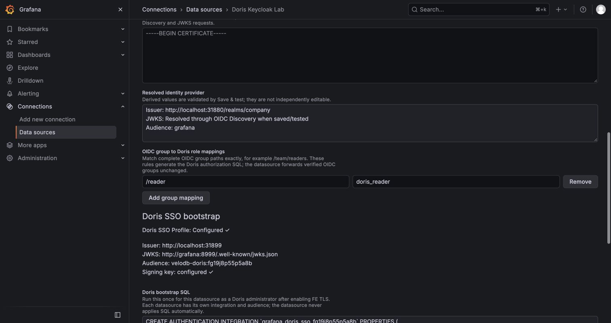

图 15：完整页面的实际 bootstrap SQL；UID 由当前数据源生成，不能照抄其他环境。

## 16. 连接成功、库表列表和实际查询验收

刷新数据源设置，以 deploy-admin 的 OIDC 会话点击 Save & test。预期 Doris SSO Profile: Configured，且出现 Doris SSO connection and SELECT 1 succeeded。

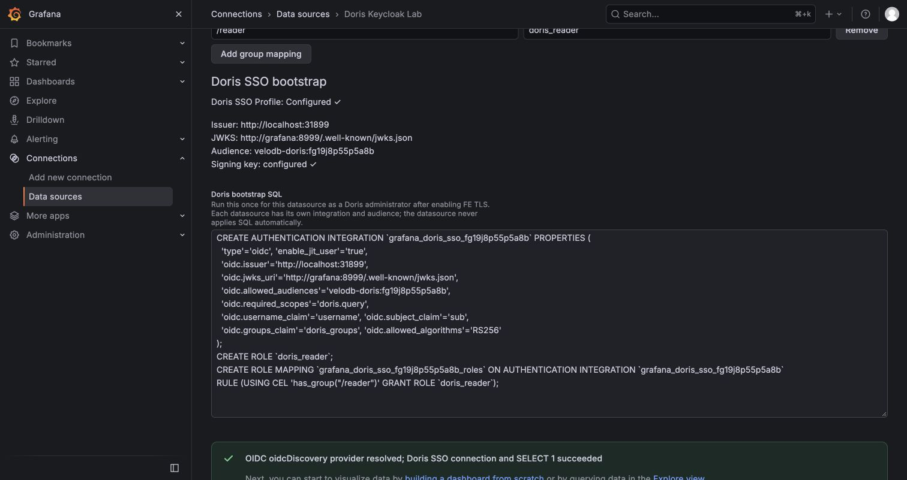

图 16a：完整桌面页面的 SSO 健康检查成功。

随后在另一浏览器配置/隐私窗口中，以 reader 通过 Keycloak 登录。普通用户不需要打开数据源管理页，也不需要 Save & test 权限。More apps → Doris App → Discover，选数据源，Database 中选 oidc_demo，Table 中选 logs，Time Field 选 timestamp，时间范围 Last 1 day，点击 Query。

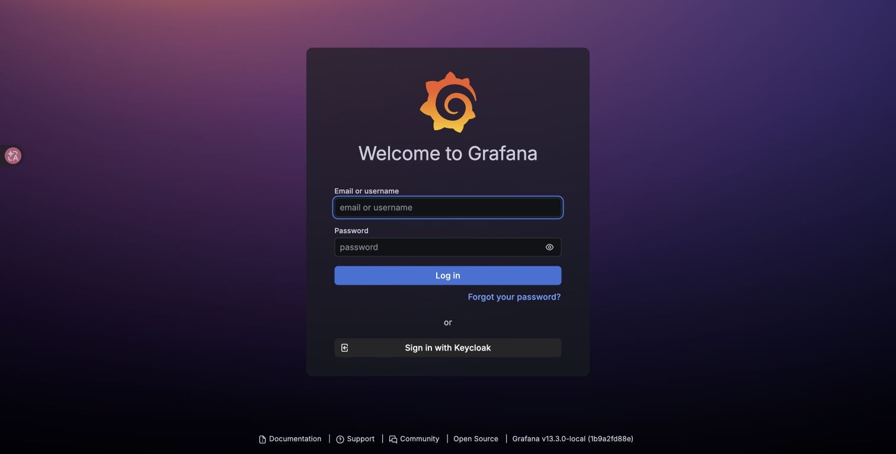

图 16b：Grafana 的 Sign in with Keycloak 登录入口。

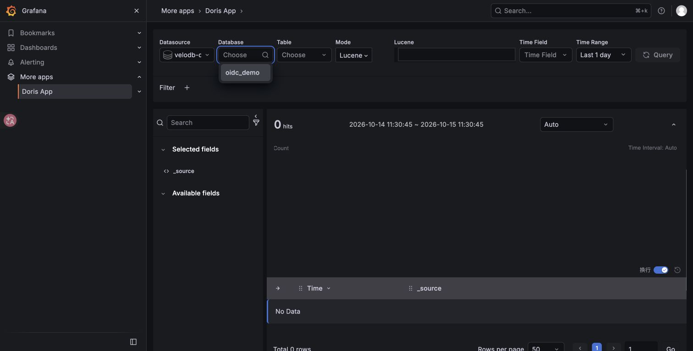

图 16c：reader 只读用户实际取得 oidc_demo 数据库列表。

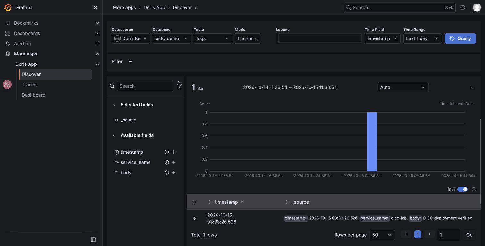

图 16d：reader 实际查询返回测试记录 OIDC deployment verified。

验收不以 SELECT 1 为终点：必须能列库、列表、读到业务数据。用户从无权限改为有权限后，退出 Grafana 和 Keycloak，再重新登录；必要时使用新的浏览器配置，避免复用另一个账号的 SSO 会话。

## 17. 无权限账号与重启持久化验收

以 outsider 登录，它没有 /reader 组。尝试访问相同库表，应被 Doris 拒绝或不返回授权库；不能因为是 Grafana Viewer 就获得 Doris 数据权限。需要记录实际拒绝结果，只有空下拉框不足以证明业务查询不可越权。

```bash
# 服务器执行，保留数据卷、签名密钥、证书和 .env
a=$(sha256sum secrets/doris-sso.pem | cut -d' ' -f1)
docker compose up -d --force-recreate grafana
docker compose restart doris
bash wait-ready.sh
b=$(sha256sum secrets/doris-sso.pem | cut -d' ' -f1)
test "$a" = "$b"
docker compose exec -T doris mysql -h127.0.0.1 -P9030 -uroot -e "SHOW FRONTEND CONFIG LIKE 'authentication_chain'; SELECT COUNT(*) FROM oidc_demo.logs;"
```

浏览器刷新并重新完成 OIDC 登录，重复步骤 16 的实际查询。不要用 docker compose down -v 作为重启命令，它会删除持久化数据。

## 18. 普通用户后续使用与排错

管理员只需为新增用户维护 Keycloak 用户组；普通用户每次只做 Keycloak 登录、选择数据源、选择获授权库表和查询，不配置证书、不执行 SQL、不创建 Doris 密码账号。此交互式身份链路不适用于无用户 OIDC 会话的 Service Account 或后台告警。

| 现象 | 检查顺序 |
|---|---|
| Keycloak 控制台一直加载 | 保持 SSH 隧道，使用 localhost URL；尝试无扩展的浏览器配置，本次发现某 Chrome 扩展配置会导致第三方 Cookie 检查超时 |
| 回调失败 / invalid redirect_uri | GF_SERVER_ROOT_URL、Client 精确回调和浏览器端口一致；没有把 localhost 改成服务器 IP |
| issuer 必须 HTTPS | 完成本验证环境的数据源 API 步骤 allowInsecureIdp；生产使用 HTTPS，不开启此测试选项 |
| unknown authority / SAN 不匹配 | Doris CA 已写入 tlsCACert，Doris host=doris，证书 SAN 包含 doris；不要关闭 TLS 校验 |
| OIDC ID token is required | 从 Keycloak 入口登录、openid scope、id_token 字段及重新登录 |
| invalid connection / FE BufferUnderflowException | 检查配套版本和下游签名密钥；本 4.1.3 镜像对较长认证报文存在限制，不靠扩大用户权限解决 |
| 健康检查成功、Database 为空 | groups mapper、用户完整组路径、role mapping、SELECT_PRIV；检查真实 Doris 拒绝信息 |
| 能选表但没有数据 | BE Alive、样例插入成功、timestamp 和查询时间范围；隔天需再次插入当前时间测试数据 |
| 重启后失败 | .env / 私钥 / CA / 数据卷仍在，fe-custom.conf 的 chain 与生成 integration 相同；重新 OIDC 登录 |

## 19. 正式部署替换清单与验证记录

正式部署改用稳定的 Grafana/Keycloak HTTPS 域名及可信 CA；Keycloak 使用正式启动模式与外部数据库，配置备份和账号策略；Doris 使用经发行方确认支持本 OIDC 协议的版本、正式 FE/BE 拓扑和证书。同步替换 root URL、Client 精确回调、OAuth URL、数据源 issuer、下游 issuer/JWKS 和对应 integration SQL，关闭两个 HTTP 测试选项。不要把本单机 Compose 直接作为生产部署文件。

2026-10-15 实测记录：第二套独立目录、全新命名数据卷；Ubuntu 22.04 x86_64 / Docker 29.1.3 / Compose 5.1.3。Keycloak 和 Doris 初始化使用配套脚本，数据源首次创建采用与表单等价的管理员 API，再执行本文 CA 与 chain 脚本；第一套环境另行验证了 UI 创建数据源。

| 验收项 | 实际结果 |
|---|---|
| 全新数据卷启动 Keycloak / Grafana / FE / BE | 通过，BE Alive=true |
| Public Client + S256 PKCE、reader 首次登录 | 通过 |
| Doris TLS CA 与 SAN 校验 | 通过，未关闭 Doris 证书校验 |
| 管理员 OIDC Save & test | 通过，SELECT 1 succeeded |
| reader 列库、列表、读取业务表 | 通过，oidc_demo.logs 返回 1 条测试记录 |
| outsider 浏览器访问 | 未返回获授权的业务库表 |
| 下游明确拒绝测试 | 同一测试身份携带 /reader 时 COUNT=1；不携带业务组时 SELECT 被 Doris 以 Access denied / Select_priv 拒绝 |
| Grafana 强制重建 + Doris 重启 | 通过，密钥校验值不变、chain 保留、样例表仍为 1 行，reader 浏览器查询成功 |
| Ubuntu 24.04 全新主机安装 Docker | 尚未实测；安装命令按官方文档核对 |
| 生产高可用、大量用户组和长 JWT | 不属于本次验收范围，长报文已发现兼容限制 |

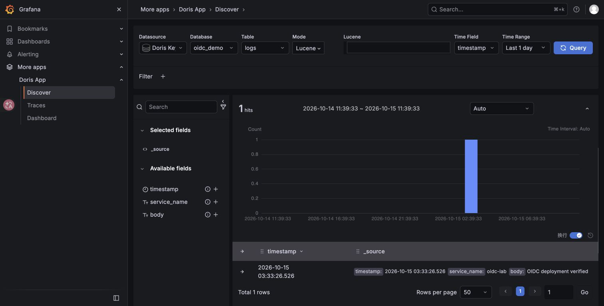

图 19：重建 Grafana、重启 Doris 后，reader 仍可查询同一条业务记录。

参考：[Docker Ubuntu 安装](https://docs.docker.com/engine/install/ubuntu/)、[Keycloak 容器](https://www.keycloak.org/server/containers)、[Keycloak 管理指南](https://www.keycloak.org/docs/latest/server_admin/)、[Grafana Generic OAuth](https://grafana.com/docs/grafana/latest/setup-grafana/configure-access/configure-authentication/generic-oauth/)、[Doris MySQL TLS](https://doris.apache.org/docs/4.x/admin-manual/auth/certificate/)。
